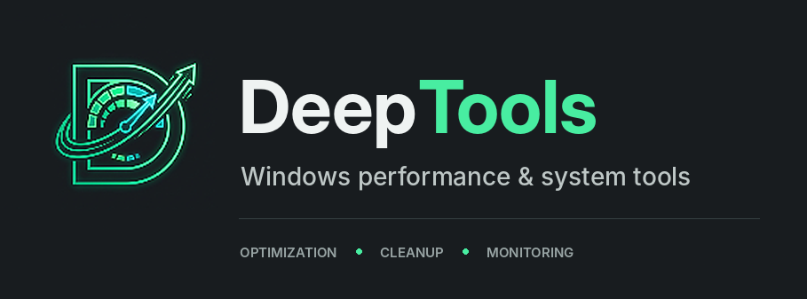
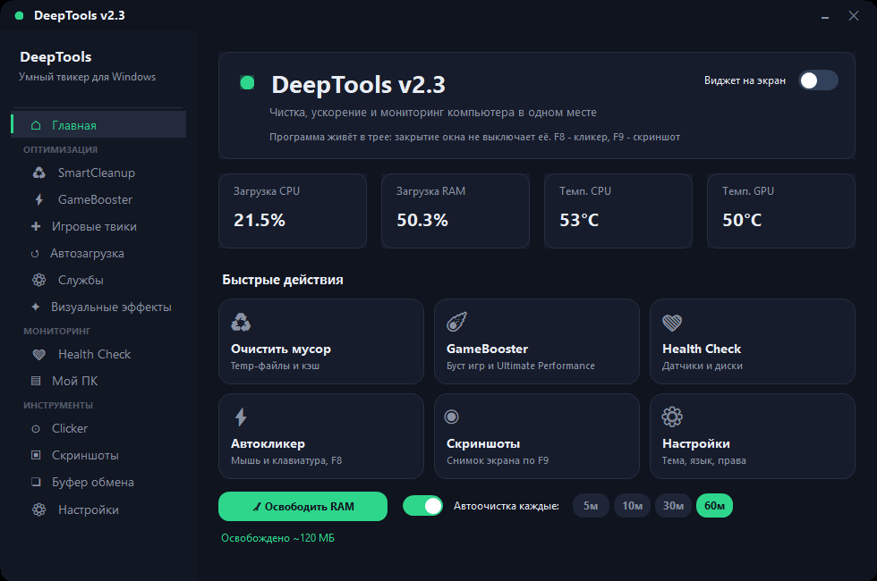
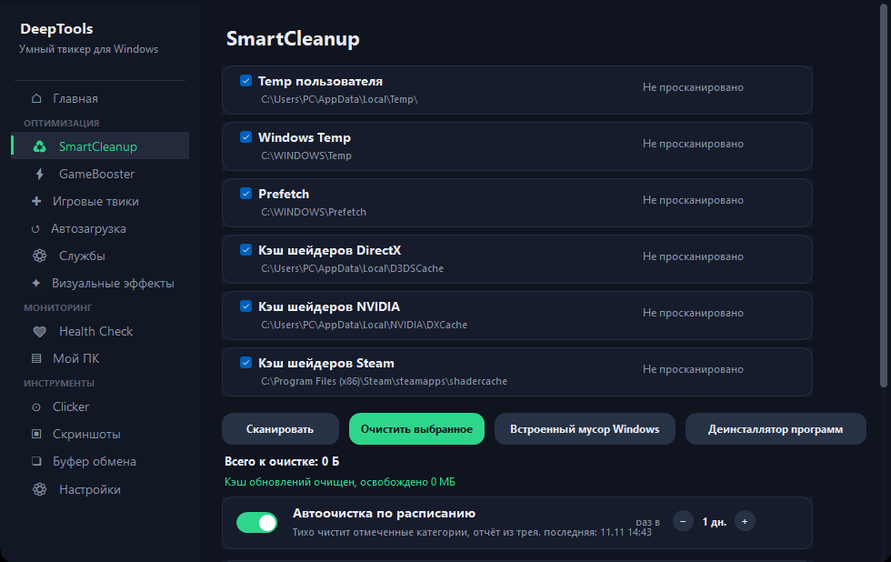
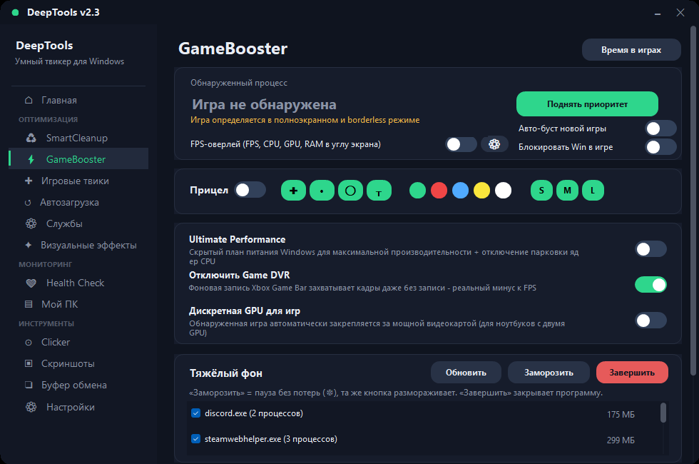
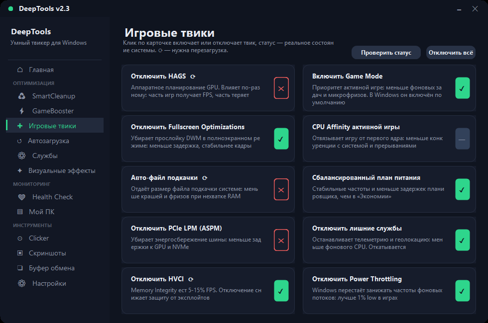
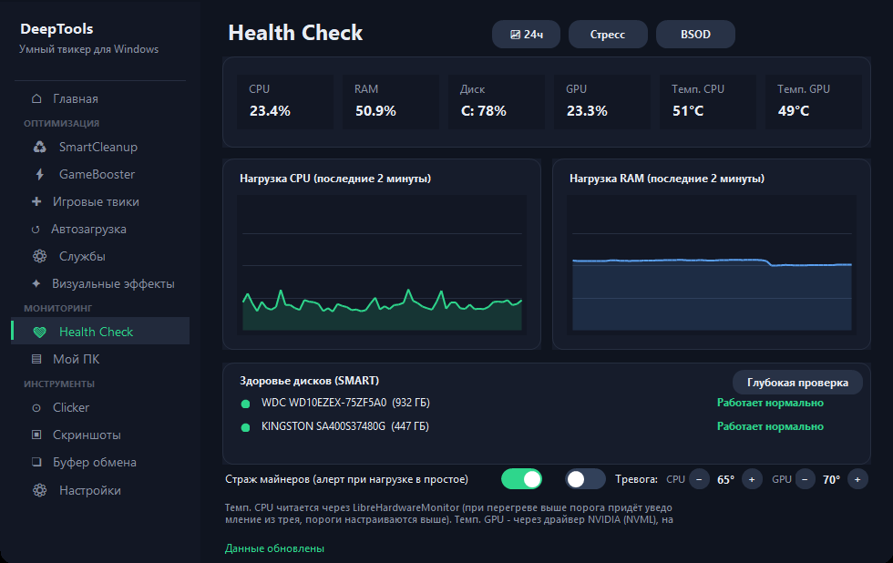
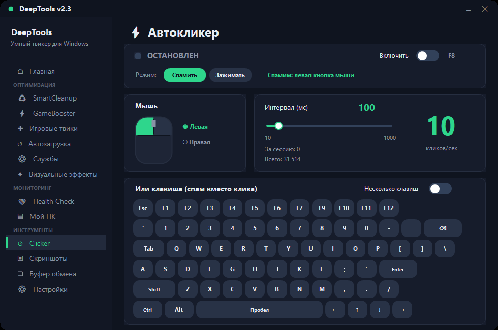

<div align="center">



# DeepTools

**Smart tweaker, cleaner and monitoring tool for Windows - in one app.**
**Умный твикер, чистильщик и монитор для Windows - всё в одном.**

[](https://github.com/dep1xar/DeepTools/releases)
[](#)
[](#)
[](https://github.com/dep1xar/DeepTools/stargazers)

**[⬇ Download latest release](https://github.com/dep1xar/DeepTools/releases/latest) · [English](#english) · [Русский](#русский)**

</div>

---

<a name="english"></a>

## English

DeepTools is a lightweight all-in-one utility for Windows 10 and 11. It clears junk, tunes the system for gaming, monitors temperatures, manages startup entries and services, removes pre-installed apps, and includes a clicker, a screenshot tool, a clipboard manager and desktop sticky notes. Everything ships as one .exe, with no installer and no background services left behind.

| | |
|---|---|
|  |  |
| **Main window**: live CPU, RAM and temperatures | **SmartCleanup**: junk, caches and leftovers |
|  |  |
| **GameBooster**: power plan, Game DVR, background apps | **Game tweaks**: real system state, one-click revert |
|  |  |
| **Health Check**: sensors, SMART, miner guard | **Autoclicker**: mouse or keyboard, configurable rate |

> [!IMPORTANT]
> DeepTools requires **administrator rights** to change power plans, services and startup entries, and to read hardware sensors. On launch it asks for elevation via the standard Windows UAC prompt.

### Why it may be flagged by antivirus

DeepTools is a system tweaker, so it does some of the same things malware does: it elevates through UAC, edits the registry and services, sends synthetic input for the clicker, and loads a kernel driver to read CPU and GPU temperatures. The release is not code-signed yet, so a few engines, mostly ML and heuristic detections such as [Trojan:Win32/Wacatac.B!ml](https://www.microsoft.com/en-us/wdsi/threats/malware-encyclopedia-description?name=Trojan%3AWin32%2FWacatac.B!ml&threatid=2147735505), may report a false positive.

- The full source is in this repository, so you can read it and build it yourself.
- Any release can be checked on [VirusTotal](https://www.virustotal.com/).
- If Windows SmartScreen warns you, click **More info → Run anyway**.

### Game Tweaks

A card grid of per-feature game tweaks: HAGS, Game Mode, the MMCSS game scheduler, fullscreen optimizations, PCIe link power management (ASPM), HVCI, Power Throttling, the page file, background telemetry services, background Store apps, Windows 11 widgets, Copilot, Recall, and CPU affinity for the running game. Each card reads the real system state instead of remembering the last click. One click applies or reverts a tweak, tweaks that need a reboot are marked **⟳**, and *Disable all* reverts everything at once.

### Extra tools

- **Program uninstaller**: lists installed programs, runs their uninstaller, then finds and removes leftover folders.
- **Sticky notes**: yellow desktop notes that stay on top and live in the tray, restored on launch (tray menu → *New note*). Each note can have a ⏰ **reminder**: set a time and the note pops to the front with a tray notification.
- **Audio switcher**: changes the default playback device (headphones ↔ speakers) from the tray menu.
- **Power quick actions**: restart straight into BIOS/UEFI, toggle Windows Fast Startup, restart Explorer.
- **Debloat**: removes pre-installed UWP apps you don't use. It shows only what is actually installed, and removal is per-user and always confirmed.
- **Stress Test**: loads every CPU core to 100% for 2 minutes and reports the peak temperature.
- **Temperature History**: 24-hour CPU/GPU graph with peak analysis.
- **Game Time**: tracks gaming sessions (playtime, average FPS, 1% low, average CPU load, peak temperatures) and reports when you close a game. Works with fullscreen and borderless games. A **Share** button renders a PNG card with your PC spec and top games. The ≡ **FPS history** chart for each game shows average FPS and 1% low across sessions with a trend verdict, so system degradation is visible at a glance. The **≡ Report** button opens frame statistics for the last 30 minutes, hour or 2 hours: average FPS, worst 1% low, and every micro-stutter with its time and duration on a timeline. Messengers, browsers, terminals and video editors are filtered out of game statistics, and recorded sessions can be deleted per game or all at once.
- **Telemetry off**: disables Windows telemetry through official policies, services and scheduler tasks. Three presets (light, medium, aggressive), live status per tweak, full revert in one click.
- **Restore point**: offered automatically before risky tweaks (debloat, service presets, telemetry) so you can roll back.
- **Crosshair**: customizable on-screen crosshair overlay (cross, dot, circle, T-shape). Settings are remembered.
- **Desktop Widget**: compact always-on-top CPU/RAM/temperature panel.

### Yandex removal

The **Remove Yandex** button in SmartCleanup also removes the Yandex search provider that Yandex Browser leaves in **Chrome, Edge, Brave, Vivaldi, Opera, Chromium, Firefox and Internet Explorer**, plus Windows URL and file associations. Close those browsers first so DeepTools can update their settings files and `Web Data` databases. It creates `.deeptools.bak` backups and removes only Yandex-related entries.

### Global hotkeys

| Key | Action |
|---|---|
| **F6** | Region screenshot |
| **F8** | Toggle clicker |
| **F9** | Full-screen screenshot |
| **F10** | Toggle FPS overlay |

### Installation

1. Go to the [Releases](https://github.com/dep1xar/DeepTools/releases) page.
2. Download the latest `DeepTools.exe`.
3. Run it. On first launch pick the interface language, then approve the UAC prompt when Windows asks for administrator rights.

No installer and nothing else to download: all libraries, including the hardware sensor engine, are embedded in the single `.exe`.

### Building from source

You need the **.NET Framework 4.x** SDK (ships with Windows and Visual Studio; the compiler is at `C:\Windows\Microsoft.NET\Framework64\v4.0.30319\csc.exe`).

Download the **whole repository** (Code → Download ZIP): every `.cs` file must be in `src/`, and every `.dll` must sit next to `build.ps1`, otherwise the build fails.

Open a PowerShell window in the project folder and run:

```powershell
powershell -NoProfile -ExecutionPolicy Bypass -File build.ps1
```

The script compiles all `.cs` files from `src/`, embeds the managed DLLs as resources and produces `DeepTools.exe` in the project folder.

It ends with a marked **BUILD OK** or **BUILD FAILED** block, so a problem never passes silently:

- **BUILD FAILED: COMPILATION ERROR**: compiler messages are printed above the banner.
- **BUILD FAILED: Missing DLL / Missing file**: the repository was unpacked partially.
- **BUILD OK, but the exe could not be installed**: `DeepTools.exe` was running. Close it (tray icon → Exit) and run the build again.

If `DeepTools.exe` is running, the script renames it to `DeepTools_old.exe` and puts the fresh build in place, so you don't have to close the app first.


### System requirements

- Windows 10 or Windows 11 (64-bit)
- .NET Framework 4.x (preinstalled on Windows 10/11)
- Administrator rights (for tweaks and sensors)

### Language

DeepTools ships in **English and Russian**. The very first launch asks you to pick a language and shows a short quick-start wizard; you can change it any time in **Settings → Appearance & language**.

### Updates

DeepTools checks GitHub Releases on launch. When an update is available, clicking the tray notification downloads and installs it: the app swaps its own exe and restarts.

---

<a name="русский"></a>

## Русский

DeepTools собирает в одном `.exe` набор утилит для Windows 10 и 11: чистит мусор, настраивает систему под игры, следит за температурами, управляет автозагрузкой и службами, удаляет предустановленные приложения, а ещё добавляет автокликер, скриншотер, менеджер буфера обмена и заметки на рабочий стол. Установщика нет, фоновых служб после закрытия тоже.

| | |
|---|---|
|  |  |
| **Главное окно**: CPU, RAM и температуры в реальном времени | **GameBooster**: план питания, Game DVR, фоновые программы |
|  |  |
| **Игровые твики**: реальное состояние системы, откат в один клик | **Health Check**: датчики, SMART, страж майнеров |

> [!IMPORTANT]
> DeepTools нужны **права администратора**, чтобы менять планы питания, службы и автозагрузку, а также читать датчики железа. При запуске программа запрашивает их через стандартное окно UAC.

### Почему антивирус может ругаться

DeepTools работает с системой на том же уровне, что и вирус: повышает права через UAC, правит реестр и службы, шлёт синтетический ввод для кликера и грузит драйвер ядра для чтения температур CPU и GPU. Релиз пока не подписан сертификатом, поэтому часть движков, в основном ML и эвристика вроде [Trojan:Win32/Wacatac.B!ml](https://www.microsoft.com/en-us/wdsi/threats/malware-encyclopedia-description?name=Trojan%3AWin32%2FWacatac.B!ml&threatid=2147735505), может дать ложное срабатывание.

- Весь исходный код лежит в этом репозитории, его можно прочитать и собрать самому.
- Любой релиз можно проверить на [VirusTotal](https://www.virustotal.com/).
- Если предупреждает Windows SmartScreen, нажми **Подробнее → Выполнить в любом случае**.
- Иногда антивирус сразу отправляет файл в карантин. Тогда добавь его в исключения.


### Игровые твики

Сетка карточек с твиками по отдельным фичам: HAGS, Game Mode, игровой планировщик MMCSS, оптимизации во весь экран, энергосбережение шины PCIe (ASPM), HVCI, Power Throttling, файл подкачки, фоновые службы телеметрии, фоновые приложения Store, виджеты Windows 11, Copilot, Recall и привязка активной игры к ядрам. Карточка показывает реальное состояние системы, а не то, что мы последний раз нажали. Один клик применяет или откатывает твик, твики с перезагрузкой помечены **⟳**, кнопка *Отключить всё* возвращает всё сразу.

### Дополнительные инструменты

- **Деинсталлятор программ**: список установленного, запуск штатного удаления, затем поиск и удаление остаточных папок.
- **Заметки-стикеры**: жёлтые заметки поверх стола, живут в трее и восстанавливаются при запуске (меню трея → *Новая заметка*). У каждой может быть ⏰ **напоминание**: задаёшь время, приходит уведомление из трея, а заметка выпрыгивает наверх.
- **Переключатель звука**: смена устройства вывода (наушники ↔ колонки) одним кликом из меню трея.
- **Быстрые действия питания**: перезагрузка прямо в BIOS/UEFI, тумблер быстрого запуска Windows, перезапуск проводника.
- **Деблоат**: удаляет предустановленные UWP-приложения. Показывает только реально установленное, удаление идёт для текущего пользователя и всегда с подтверждением.
- **Стресс-тест**: грузит все ядра CPU на 100% две минуты и показывает пиковую температуру.
- **История температур**: график CPU/GPU за 24 часа с разбором пиков.
- **Время в играх**: считает игровые сессии (время, средний FPS, 1% low, средний CPU, пиковые температуры) и шлёт отчёт при закрытии игры. Работает с полноэкранными и borderless-играми. Кнопка **Поделиться** рендерит PNG-карточку со спекой ПК и топом игр. График ≡ **истории FPS** по каждой игре показывает средний FPS и 1% low по сессиям с вердиктом тренда, так что деградация системы видна сразу. Кнопка **≡ Отчёт** открывает статистику кадров за последние 30 минут, час или 2 часа: средний FPS, худший 1% low и каждый микрофриз с временем и длительностью на таймлайне. Мессенджеры, браузеры, терминалы и видеоредакторы в статистику игр не попадают, а записанные сессии можно убрать по одной или все сразу.
- **Отключение телеметрии**: выключает телеметрию Windows через официальные политики, службы и задачи планировщика. Три пресета (мягко, средне, жёстко), живой статус каждого твика, полный откат одной кнопкой.
- **Точка восстановления**: предлагается автоматически перед рискованными твиками (деблоат, пресеты служб, телеметрия), чтобы всегда можно было откатиться.
- **Прицел**: настраиваемый накладной прицел (крест, точка, круг, T-образный). Настройки запоминаются.
- **Виджет на рабочий стол**: компактная плашка CPU/RAM/температуры, всегда поверх окон.

### Удаление Яндекса

Кнопка **Удалить Яндекс** в SmartCleanup убирает и поисковую систему Яндекса, которую Яндекс.Браузер оставляет в **Chrome, Edge, Brave, Vivaldi, Opera, Chromium, Firefox и Internet Explorer**, плюс ассоциации ссылок и файлов Windows. Перед удалением закрой эти браузеры, чтобы DeepTools мог обновить их настройки и базы `Web Data`. Программа делает резервные копии `.deeptools.bak` и удаляет только записи, связанные с Яндексом.

### Глобальные горячие клавиши

| Клавиша | Действие |
|---|---|
| **F6** | Скриншот области |
| **F8** | Вкл/выкл кликер |
| **F9** | Скриншот всего экрана |
| **F10** | Вкл/выкл FPS-оверлей |

### Установка

1. Открой страницу [Releases](https://github.com/dep1xar/DeepTools/releases).
2. Скачай свежий `DeepTools.exe`.
3. Запусти. При первом запуске выбери язык, затем подтверди UAC, когда система попросит права администратора.

Установщика нет, докачивать зависимости не нужно: все библиотеки, включая движок датчиков, встроены в один `.exe`.

### Сборка из исходников

Нужен **.NET Framework 4.x** SDK (идёт с Windows и Visual Studio; компилятор лежит по пути `C:\Windows\Microsoft.NET\Framework64\v4.0.30319\csc.exe`).

Скачай **весь репозиторий** (Code → Download ZIP): все `.cs` должны лежать в `src/`, а все `.dll` рядом с `build.ps1`, иначе сборка не пройдёт.

Открой PowerShell в папке проекта и запусти:

```powershell
powershell -NoProfile -ExecutionPolicy Bypass -File build.ps1
```

Скрипт компилирует все `.cs`-файлы из `src/`, встраивает managed-библиотеки как ресурсы и создаёт `DeepTools.exe` в папке проекта.

В конце печатается заметный блок **BUILD OK** или **BUILD FAILED**, так что ошибка не проходит молча:

- **BUILD FAILED: COMPILATION ERROR**: текст ошибок компилятора напечатан над баннером.
- **BUILD FAILED: Missing DLL / Missing file**: репозиторий распакован не полностью.
- **BUILD OK, but the exe could not be installed**: `DeepTools.exe` был запущен. Закрой его (трей → Выход) и запусти сборку снова.

Если `DeepTools.exe` сейчас запущен, скрипт переименует его в `DeepTools_old.exe` и подставит свежую сборку, так что закрывать программу заранее не обязательно.


### Системные требования

- Windows 10 или Windows 11 (64-бит)
- .NET Framework 4.x (предустановлен в Windows 10/11)
- Права администратора (для твиков и датчиков)

### Язык

DeepTools доступен на **русском и английском**. При самом первом запуске программа спрашивает язык и показывает короткий мастер знакомства; сменить язык можно в любой момент в **Настройки → Внешний вид и язык**.

### Обновления

DeepTools проверяет GitHub Releases при запуске. Когда выходит новая версия, клик по уведомлению из трея скачивает и устанавливает её: программа сама подменяет свой exe и перезапускается.

---

<div align="center">

© 2026 dep1xar · DeepTools

</div>
